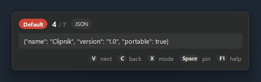
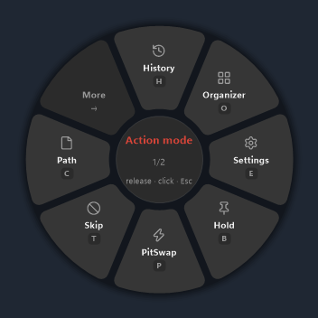
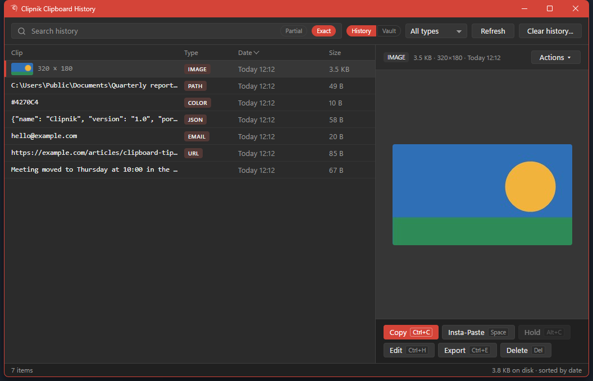

# Clipnik

A keyboard-first clipboard manager for Windows. Clipnik keeps everything you copy on a stack, and pasting can
walk that stack: hold **Ctrl**, tap **V** to step back through what you copied earlier, and let go of Ctrl to
paste the clip you landed on.

## What it does

- **Paste mode.** Hold Ctrl and press V. Each further V steps to a clip you copied earlier, C steps back toward
  the newest, and a card near your pointer shows where you are. Keys on the card search the stack (F), change how the
  clip is pasted (Z), paste several clips in a row (Enter), or lock the card open so you can let go of Ctrl (L).
  F1 shows every key without leaving paste mode.
- **Paste formats.** Paste as plain text, strip tracking parameters from a link, turn a URL into a Markdown
  link, change case, pretty-print or minify JSON, and more, from a ring at your pointer.
- **Channels.** Separate stacks for separate work. The Channel Organizer moves, edits and deletes clips. A
  channel named `pit` keeps what you copy there out of your history, for passwords and throwaway clips.
- **Clipboard History.** Everything you copied, searchable, with thumbnails for images. Text is kept for 30
  days and images for 7 by default.
- **The Vault.** Clips you want to keep for good, named and ordered your way, never pruned.
- **Clips know what they are.** Links, email addresses, colors, file paths, JSON, code, phone numbers and
  images are recognized when copied, and offer the actions that fit: open, compose, reveal, prettify.
- **Rules.** At copy time, send matching clips to a channel, tag them, rewrite them, or ignore them, by what
  the clip is, a pattern, or the app it came from.
- **Action Mode** (Ctrl+Shift+A) opens every other tool from one ring: History, the Organizer, Settings, Hold
  clip, the pit, and so on. Prefer plain lists? Settings, Appearance, Menu style: List.
- **Portable.** No installer and no administrator rights. Clipnik, its settings and your clips all live in
  its own folder, so it runs from a USB stick too.

## Requirements

- Windows 10 or 11, 64-bit.
- The Microsoft Edge WebView2 Runtime, for Clipboard History, the Channel Organizer and Help. Windows 11
  includes it, and so do most up-to-date Windows 10 PCs. If it is missing, Clipnik says so and links to
  [Microsoft's download page](https://developer.microsoft.com/microsoft-edge/webview2/); everything else keeps working.

Clipnik runs on AutoHotkey v2, which comes in the zip: there is nothing else to install.

## Install

1. Download `Clipnik-1.0.zip` from the [Releases](https://github.com/mpeutz/Clipnik/releases) page.
2. Unzip it anywhere you can write to, such as your Documents folder or a USB stick.
3. Run `Clipnik.cmd`. Clipnik's icon appears in the notification area, and the first time a short note
   confirms it is running.

To start Clipnik when you sign in, open its tray menu and turn on **Run at startup**.

Clipnik does not run as administrator, so it cannot paste into programs that do. Everything else works as usual.

## Your data

Everything Clipnik keeps is inside its folder:

| Where | What |
| --- | --- |
| `settings.ini` | Your settings, written on first start |
| `cache\clips*` | The clips in each channel |
| `cache\data.db` | Clipboard History and the Vault |
| `cache\history`, `cache\vault`, `cache\thumbs*` | Images and thumbnails |

To back up, copy the folder. To remove Clipnik, turn off **Run at startup** if you turned it on, exit Clipnik
from its tray menu, and delete the folder.

## Help

Press Ctrl+Shift+A, then F1, for the built-in Help: getting started, every key and setting, and troubleshooting.

## Credits and license

Clipnik is a modified version of [Clipjump](https://github.com/aviaryan/Clipjump) 12.5 by Avi Aryan, ported to
AutoHotkey v2 with a new interface and new features. It is released under a new name and is not endorsed by
the original author.

Licensed under the [Apache License 2.0](LICENSE). Bundled third-party components and their licenses are listed
in [NOTICE.txt](NOTICE.txt).

## Development

This repository is the portable folder itself: run `Clipnik.cmd` from a clone.

- `tests/run-all.sh` runs the unit tests from Git Bash.
- `tools/test-sandbox.sh` runs the whole suite, including the tests that drive Clipnik, against a throwaway copy.
  It stops your own Clipnik while it runs and restarts it afterwards; keep your hands off the keyboard meanwhile.
- `tools/make-release.sh` builds the release zip from the committed HEAD, and
  `tools/test-sandbox.sh --release dist/Clipnik-1.0.zip` checks its first start the same safe way.
